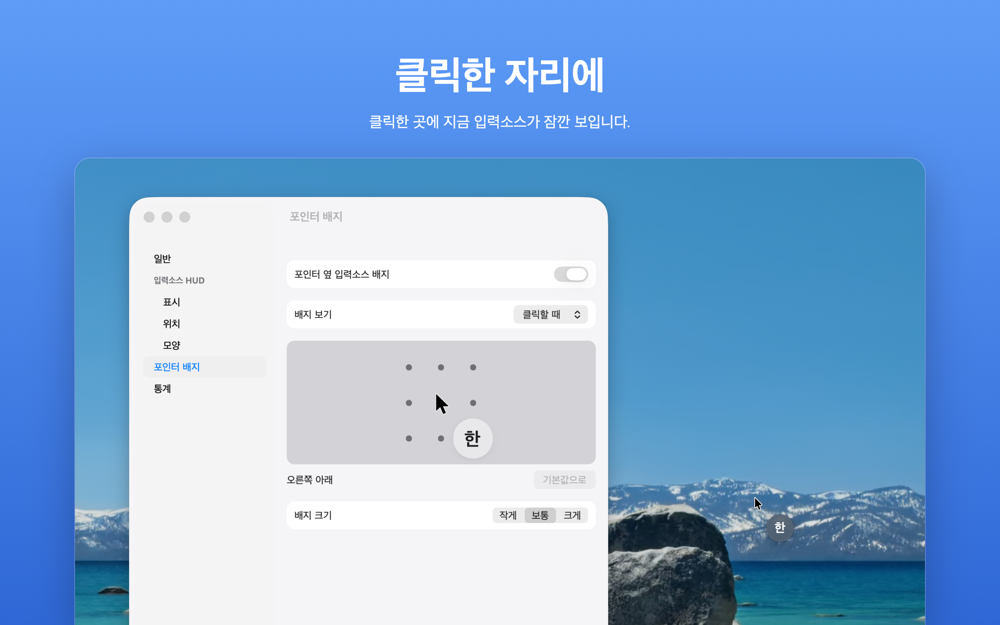
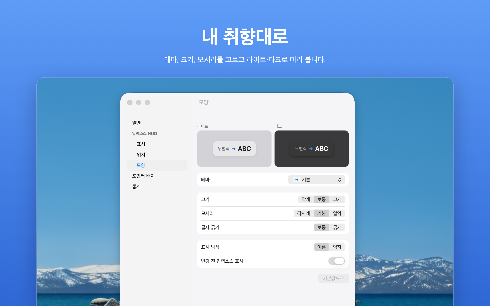
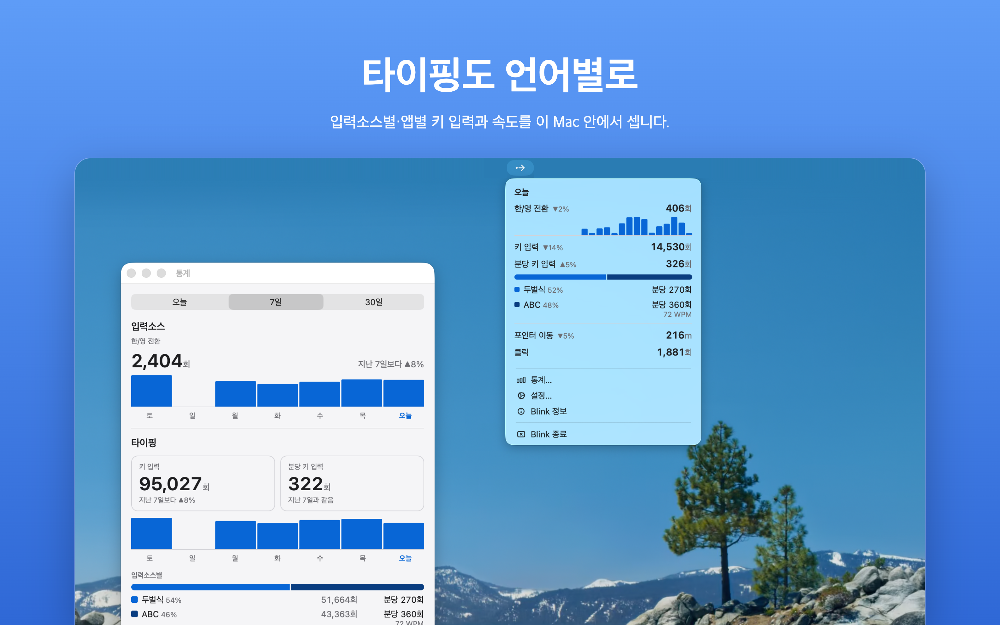

<h1 align="center">Blink</h1>

<p align="center">
  <strong>입력소스가 바뀌는 순간, 화면에 눈 깜빡할 만큼.</strong>
</p>

<p align="center">
  <a href="https://apps.apple.com/kr/app/blink-input-language-alert/id6823983837">Mac App Store</a> ·
  <a href="CHANGELOG.ko.md">변경 이력</a> ·
  <a href="https://nostrss.github.io/blink-site/privacy">개인정보</a> ·
  <a href="LICENSE">MIT</a> ·
  <a href="README.md">English</a>
</p>

<p align="center">
  
</p>

<p align="center">
  <sub><em>바꾸는 순간, 무엇에서 무엇으로 바뀌었는지 알려 줍니다.</em></sub>
</p>

---

## 이게 뭔가요?

hello를 쳤는데 "ㅗ디ㅣㅐ"가, 안녕하세요를 쳤는데 "dkssudgktpdy"가 나옵니다. 문장을 다 쓰고 나서야 알아채고, 지우고, 다시 칩니다.

Blink는 그 일을 끝내는 macOS 메뉴바 앱입니다. 키보드 입력소스가 바뀌는 순간 "ABC → 두벌식"처럼 "변경 전 → 변경 후"를 화면 가운데에 1초쯤 띄우고 사라집니다. 작업을 가리지 않고, 클릭도 그대로 통과합니다.

한 가지 일을 하는 작은 앱이고, 원하면 켤 수 있는 기능이 몇 개 더 있습니다.

---

## Blink로 하는 것

- **엉뚱한 언어로 치는 일을 막습니다.** 마우스가 있는 화면에, 전체화면 앱 위와 모든 Space에서 HUD가 뜹니다.
- **포인터 옆에 지금 언어를.** 포인터 배지가 지금 입력소스를 항상, 움직일 때, 또는 클릭한 자리에 보여 줍니다.
- **Caps Lock도 놓치지 않게.** 누르면 "⇪ 켜짐"·"⇪ 꺼짐"(원할 때만).
- **하루를 세어 봅니다.** 한/영 전환, 포인터 이동, 클릭, 스크롤. 타이핑 통계를 켜면 입력소스별·앱별 키 입력과 분당 키 입력까지.
- **내 취향대로.** 9군데 위치 또는 끌어서 원하는 자리에, 0.5–5초, 이름 그대로 또는 "EN"·"한" 같은 약자, Liquid Glass부터 Dracula까지 테마.

---

## 둘러보기

<table>
  <tr>
    <td width="50%" valign="top">
      <br>
      <sub><strong>클릭한 자리에.</strong> 클릭한 곳에 배지가 잠깐 보였다가 사라집니다.</sub>
    </td>
    <td width="50%" valign="top">
      <br>
      <sub><strong>내 취향대로.</strong> 테마, 크기, 모서리를 고르고 라이트·다크로 미리 봅니다.</sub>
    </td>
  </tr>
  <tr>
    <td colspan="2" valign="top">
      <br>
      <sub><strong>타이핑도 언어별로.</strong> 입력소스별·앱별 키 입력과 속도를 이 Mac 안에서 셉니다.</sub>
    </td>
  </tr>
</table>

---

## 개인정보, 쉽게

Blink는 App Sandbox에서 실행되고, 인터넷에 접속하지 않으며, 아무것도 수집하지 않습니다.

- 화면에 그리기 위해 현재 입력소스, Caps Lock 상태, 포인터 위치를 읽습니다.
- 통계는 이 Mac 안에만 남습니다. 설정 > 통계에서 언제든 끄거나 지울 수 있습니다.
- 타이핑 통계는 직접 켜기 전까지 꺼져 있습니다. 켜면 입력 모니터링 권한을 묻고, 누른 키의 개수만 셀 뿐 어떤 키를 눌렀는지, 무엇을 입력했는지는 기록하지 않습니다.

자세한 내용은 [개인정보 처리방침](https://nostrss.github.io/blink-site/privacy)에 있습니다.

---

## 시작하기

### 그냥 쓰고 싶어요

[Mac App Store](https://apps.apple.com/kr/app/blink-input-language-alert/id6823983837)에서 받으세요. macOS 13 Ventura 이상이 필요합니다. Blink는 메뉴바(•→)에 있고 Dock 아이콘은 없습니다.

HUD가 뜨려면 입력소스가 둘 이상이어야 합니다. 시스템 설정 > 키보드 > 입력 소스에서 추가하세요.

### 소스에서 빌드하고 싶어요

Xcode가 필요합니다. 외부 라이브러리는 없습니다.

```bash
git clone https://github.com/nostrss/blink.git && cd blink
DEVELOPER_DIR=/Applications/Xcode.app/Contents/Developer xcodebuild -project Blink.xcodeproj -scheme Blink -configuration Debug -derivedDataPath build test
open -n "$PWD/build/Build/Products/Debug/Blink Dev.app"
```

Debug 빌드는 **Blink Dev**(`com.jintaek.blink.dev`, 메뉴바 아이콘에 점)입니다. 설정·통계·권한을 따로 써서 App Store판을 건드리지 않습니다. 먼저 App Store판 Blink를 끄세요. 둘 다 켜 두면 HUD가 두 번 뜹니다.

내 팀으로 서명하려면 Xcode의 Signing & Capabilities에서 팀을 바꾸세요.

---

## 이런 앱은 아닙니다

- 입력소스를 바꿔 주는 앱이 아닙니다. Blink는 바뀐 걸 보여 주고, 바꾸는 건 macOS가 합니다.
- 키로거가 아닙니다. 타이핑 통계를 켜도 키의 개수만 세고, 무슨 키인지는 모릅니다.
- 수다스럽지 않습니다. HUD 하나, 1초쯤, 그리고 비켜 줍니다.

---

<p align="center">
  <sub>질문, 버그 제보, 의견: <a href="mailto:blinkapp.support@gmail.com">blinkapp.support@gmail.com</a></sub><br>
  <sub>코드는 <a href="LICENSE">MIT 라이선스</a>입니다. Blink 이름과 아이콘은 라이선스에 포함되지 않습니다.</sub>
</p>
