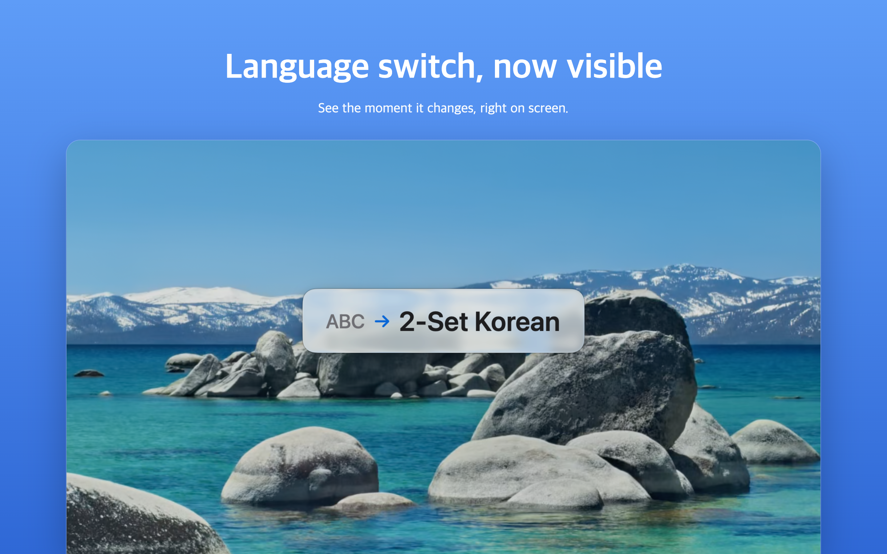
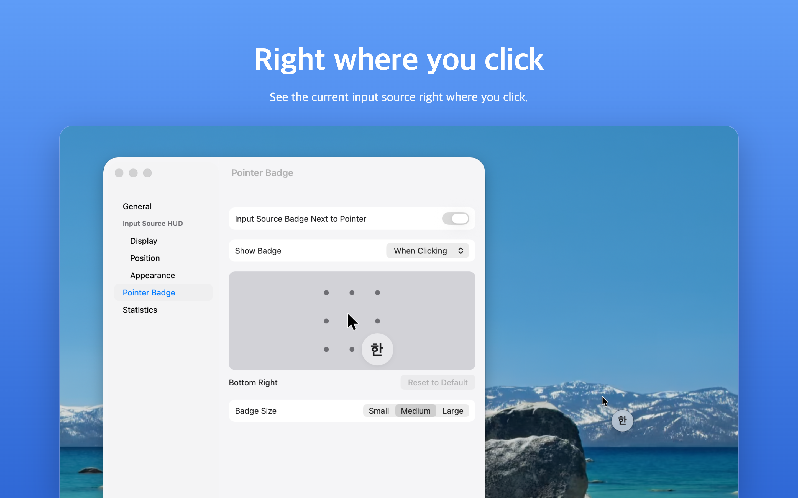
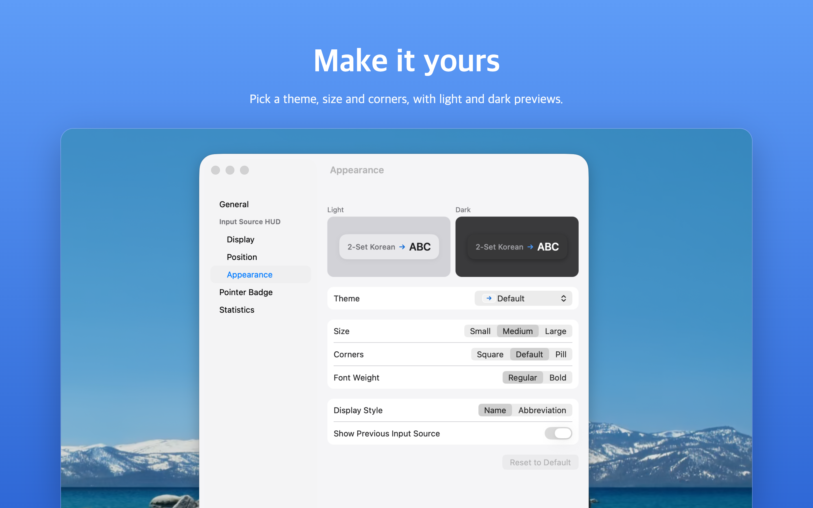
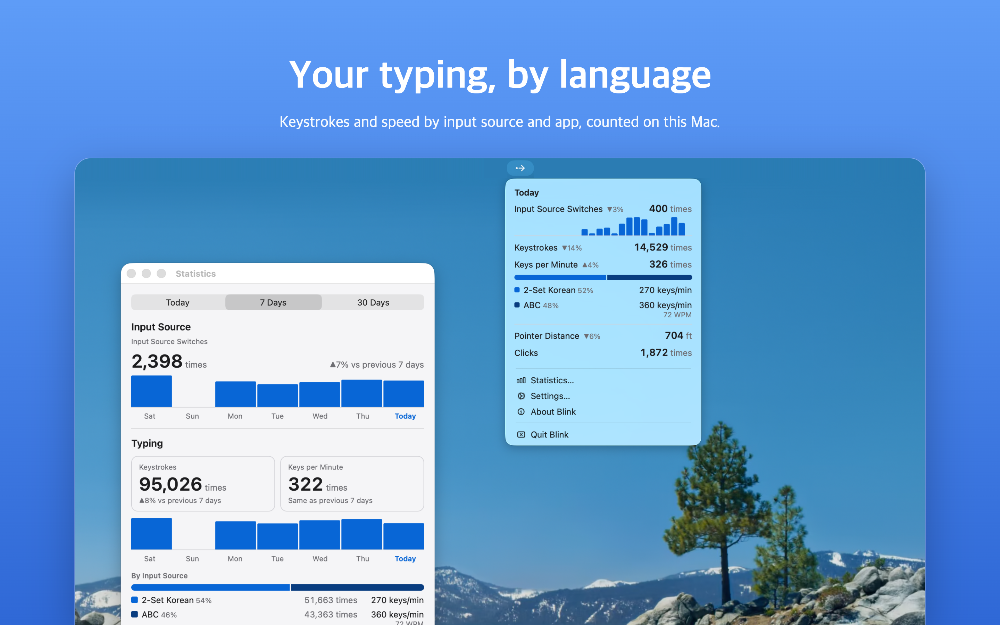

<h1 align="center">Blink</h1>

<p align="center">
  <strong>See your input source change, right on screen. For the blink of an eye.</strong>
</p>

<p align="center">
  <a href="https://apps.apple.com/app/blink-input-language-alert/id6823983837">Mac App Store</a> ·
  <a href="CHANGELOG.md">Changelog</a> ·
  <a href="https://nostrss.github.io/blink-site/privacy">Privacy</a> ·
  <a href="LICENSE">MIT</a> ·
  <a href="README.ko.md">한국어</a>
</p>

<p align="center">
  
</p>

<p align="center">
  <sub><em>The moment you switch, Blink tells you what you switched from and to.</em></sub>
</p>

---

## What is this, really?

You type a whole sentence, look up, and it came out as "ㅗ디ㅣㅐ" instead of "hello". You delete it and type it all again.

Blink is a macOS menu bar app that ends that. The moment your keyboard input source changes, it shows "previous → new", like "ABC → 2-Set Korean", in the middle of your screen for about a second. Then it's gone. It never covers your work, and clicks pass straight through.

It's a small app that does one thing, plus a few things around it you can turn on if you want.

---

## Stuff you do with Blink

- **Stop typing in the wrong language.** The HUD shows up on the screen where your mouse is, above full-screen apps and on every Space.
- **Keep the language next to your pointer.** The pointer badge shows the current input source always, while moving, or right where you click.
- **Catch Caps Lock.** "⇪ On" or "⇪ Off" when you press it, if you want it.
- **Count your day.** Input source switches, pointer travel, clicks and scrolling. Turn on typing statistics to see keystrokes and keys per minute by input source and app.
- **Make it yours.** Nine positions or drag anywhere, 0.5 to 5 seconds, full names or short labels like "EN" and "한", and themes from Liquid Glass to Dracula.

---

## A look inside

<table>
  <tr>
    <td width="50%" valign="top">
      <br>
      <sub><strong>Right where you click.</strong> The badge shows up at the click and fades away.</sub>
    </td>
    <td width="50%" valign="top">
      <br>
      <sub><strong>Make it yours.</strong> Theme, size and corners, with light and dark previews.</sub>
    </td>
  </tr>
  <tr>
    <td colspan="2" valign="top">
      <br>
      <sub><strong>Your typing, by language.</strong> Keystrokes and speed by input source and app, counted on this Mac.</sub>
    </td>
  </tr>
</table>

---

## Privacy, plainly

Blink runs in the App Sandbox, never connects to the internet and collects nothing.

- To draw on screen, it reads the current input source, the Caps Lock state and where your pointer is.
- Statistics stay on your Mac. Turn them off or clear them anytime in Settings > Statistics.
- Typing statistics are off until you turn them on. Then Blink asks for Input Monitoring and counts only how many keys you press, never which keys or what you type.

The full version is the [Privacy Policy](https://nostrss.github.io/blink-site/privacy).

---

## Getting started

### I just want to use it

Get it from the [Mac App Store](https://apps.apple.com/app/blink-input-language-alert/id6823983837). Requires macOS 13 Ventura or later. Blink lives in the menu bar (•→); there's no Dock icon.

You need at least two input sources for the HUD to appear. Add one in System Settings > Keyboard > Input Sources.

### I want to build it from source

You need Xcode. There are no third-party dependencies.

```bash
git clone https://github.com/nostrss/blink.git && cd blink
DEVELOPER_DIR=/Applications/Xcode.app/Contents/Developer xcodebuild -project Blink.xcodeproj -scheme Blink -configuration Debug -derivedDataPath build test
open -n "$PWD/build/Build/Products/Debug/Blink Dev.app"
```

The Debug build is **Blink Dev** (`com.jintaek.blink.dev`, a dot on the menu bar icon). It keeps its own settings, statistics and permissions, so it won't touch the App Store version. Quit the App Store Blink first, or you'll see the HUD twice.

To sign with your own team, change the team in Xcode under Signing & Capabilities.

---

## What it is not

- Not an input source switcher. Blink shows the change; switching stays with macOS.
- Not a keylogger. Even with typing statistics on, it counts keys, never what they are.
- Not chatty. One HUD, about a second, then out of your way.

---

<p align="center">
  <sub>Questions, bugs or feedback: <a href="mailto:blinkapp.support@gmail.com">blinkapp.support@gmail.com</a></sub><br>
  <sub>Code under the <a href="LICENSE">MIT License</a>. The Blink name and icon are not covered by it.</sub>
</p>
